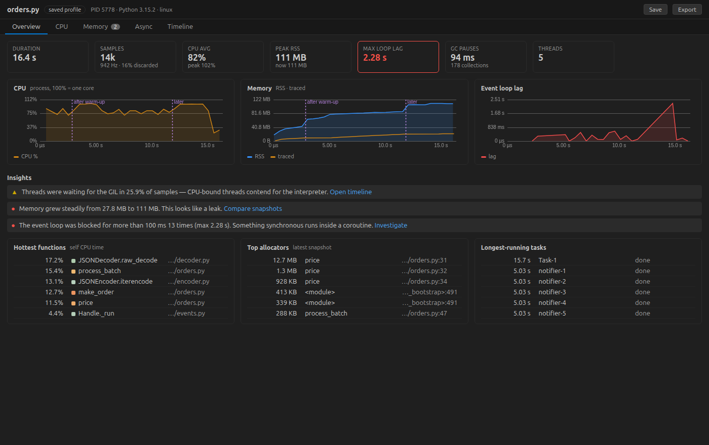
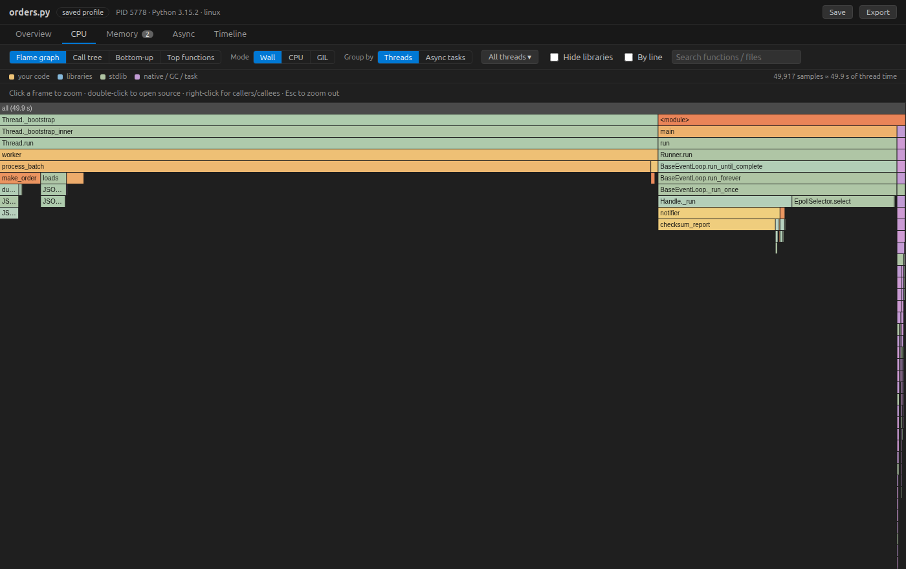
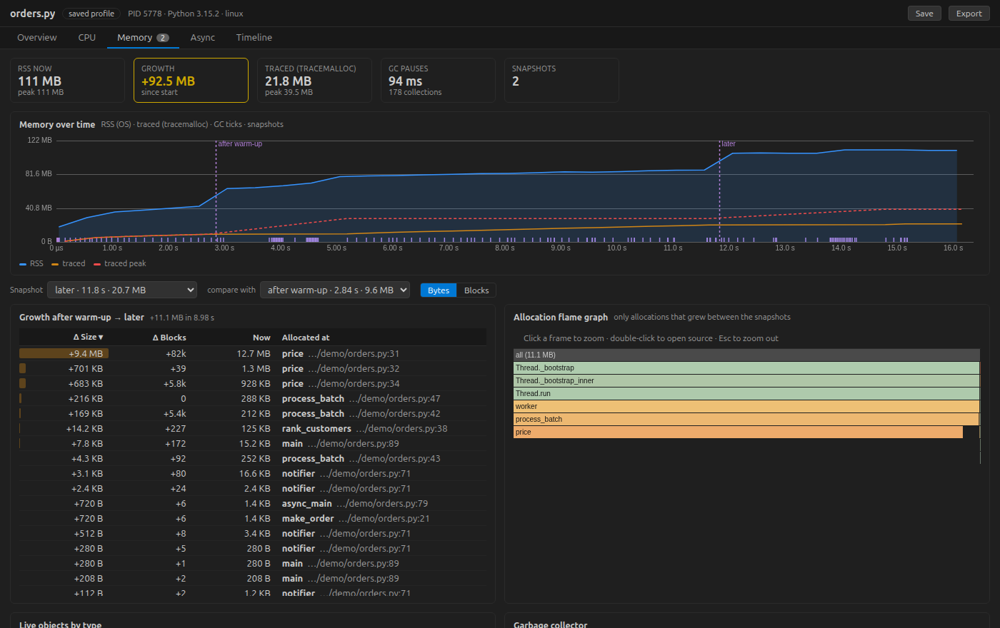
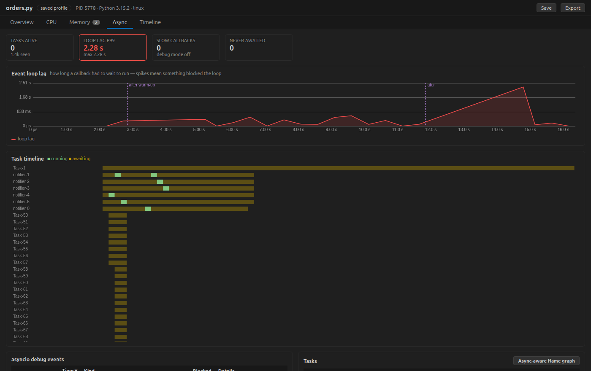
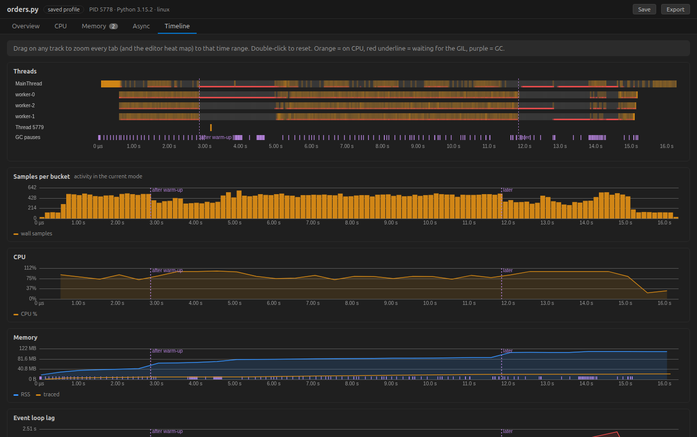

# Python Profiler for VS Code (Tachyon)

CPU, memory and asyncio profiling for **Python 3.15+**, built into VS Code. It uses
CPython's built-in sampling profiler **Tachyon** (`profiling.sampling`, PEP 799), safe
remote code execution (`sys.remote_exec`, PEP 768) and asyncio introspection. Nothing
is installed into your environment and your code needs no changes.

- **Start with the profiler**, or **attach** to a program that is already running, on Windows, Linux and macOS
- **Live dashboard**: overview with automatic insights, flame graph, call tree, bottom-up view, top functions, callers/callees
- **Wall / CPU / GIL views** from one recording (each sample keeps its thread state)
- **Memory**: RSS and traced memory over time, tracemalloc snapshots, a **snapshot diff for leak hunting**, allocation flame graph, live object counts, GC pauses
- **asyncio**: task timeline (Gantt), async-aware flame graph, **event-loop lag**, asyncio debug mode (slow callbacks, never-awaited coroutines)
- **Editor integration**: per-line heat in the gutter, inline timings and CodeLens on hot functions. These follow the dashboard's time range, mode and thread filter
- **Timeline**: threads (on-CPU and GIL waits), GC, CPU, memory and loop lag on one time axis. Drag to zoom every view
- Saved `.vspyprof` files open in the dashboard. Export to speedscope or collapsed stacks

## Requirements

- **VS Code 1.95+** with the [Python extension](https://marketplace.visualstudio.com/items?itemName=ms-python.python)
  (installed automatically).
- **Python 3.15 or newer** for the program you profile. Tachyon, `sys.remote_exec` and the asyncio
  introspection the profiler relies on are new in 3.15. If the selected interpreter is older, the
  profiler offers to pick another one or to create a 3.15 venv.
- Local folders, WSL, SSH and Dev Containers work: the profiler runs where your Python runs.

## Starting a profile

| You want to… | Do this |
|---|---|
| Profile the current file | ▶ dropdown in the editor title → **Profile Python File** |
| Reuse an existing debug config (FastAPI, Django, module…) | **Python Profiler: Profile Launch Configuration…** Your `debugpy` configurations run unchanged, with the profiler instead of the debugger. Without (or beside) them it offers default configurations like the Python debugger: Python File, Module, FastAPI, Django, pytest, Attach |
| Write a dedicated config | `launch.json` → *Add Configuration* → **Python Profiler: …** snippets (`"type": "python-profiler"`) |
| Profile a test | right-click in a test file → **Profile Test at Cursor** |
| Profile a running process | sidebar **Python Processes**, or **Attach Profiler to Process…** |

The extension doesn't manage environments. It uses the interpreter the **Python
extension** selected for each file or folder (venv, uv, Poetry, conda, pyenv; multi-root
aware), plus your `.env`/`envFile`/`env`/`cwd`/`args`. If the interpreter is older than 3.15,
you get a one-click fix: select another interpreter or create a 3.15 venv (uses `uv` when
available).

### Attach permissions

| OS | Notes |
|---|---|
| Linux | Same user. With `kernel.yama.ptrace_scope=1` (the default on Ubuntu) you can only attach to processes **started through the profiler**, which call `PR_SET_PTRACER` for us. Otherwise run `sudo sysctl kernel.yama.ptrace_scope=0`. Containers need `--cap-add=SYS_PTRACE`. |
| macOS | Reading another process's memory requires root. Start programs with the profiler, or run VS Code with elevated rights to attach. |
| Windows | Same user works. Elevated or service processes need an elevated VS Code. venv launcher stubs are resolved to the real interpreter automatically. |

Attaching injects a small agent through `sys.remote_exec` (for memory and asyncio
debug). If the target disabled remote debugging (`PYTHON_DISABLE_REMOTE_DEBUG`), CPU
sampling, task graphs and GC stats still work.

## A tour

**CPU.** Flame graph, call tree, bottom-up view and top functions, in wall-clock, CPU or GIL time,
grouped by thread or by asyncio task. Click to zoom, double-click to open the source, right-click for
callers and callees.

**Memory.** Take tracemalloc snapshots while the program runs and compare two of them: the table and
the allocation flame graph show only what grew in between, which is usually the leak.

**asyncio.** Event-loop lag shows when something blocked the loop; the task timeline shows what each
task did and when; asyncio debug mode reports slow callbacks and coroutines that were never awaited.

**Timeline.** Every thread (on CPU, waiting for the GIL, in GC), CPU, memory and loop lag on one time
axis. Drag across any track to narrow every tab, and the editor heat map, to that time range.

## Overhead

CPU sampling reads your program from outside, so it barely changes it. tracemalloc and asyncio
debug mode run *inside* it: turn them on to find a leak or a blocking call, and leave them off when
you measure CPU time. The dashboard says so when asyncio debug mode shows up in the profile.

Measured on Linux with Python 3.15.2, on a JSON/regex/Decimal workload with one and with four
threads (median of five runs, 1 kHz sampling):

| Mode | Slowdown |
|---|---|
| CPU sampling (default) | under 1 % |
| `blockingSampling` | 15–25 % |
| tracemalloc, 1 frame per allocation | about 6× |
| tracemalloc, 8–16 frames (default 16) | about 23× |
| asyncio debug mode | depends on how many tasks and callbacks the program creates; 30 % of CPU time in a task-heavy demo |

tracemalloc costs as much without the profiler (`python -X tracemalloc=16`); it is CPython's
allocation tracer, not the profiler, that slows allocation-heavy code down.

## Settings

| Setting | Default | What it does |
|---|---|---|
| `vspyprof.samplingRate` | `1000` | Stack samples per second. |
| `vspyprof.blockingSampling` | `false` | Pause the target's threads for each sample. Removes discarded samples on busy multi-threaded programs, but slows the program by 15–25 %. |
| `vspyprof.nativeFrames` | `false` | Show `<native>` frames for time spent in C code. |
| `vspyprof.memory.tracemallocOnStart` | `false` | Start tracemalloc with the session. Slows allocation-heavy code several times over (see [Overhead](#overhead)). |
| `vspyprof.memory.tracebackFrames` | `16` | Frames recorded per allocation. |
| `vspyprof.asyncio.debugOnStart` | `false` | Turn on asyncio debug mode with the session. |
| `vspyprof.asyncio.slowCallbackMs` | `100` | Callbacks that block the event loop longer than this are reported. |
| `vspyprof.heatMap.enabled` | `true` | Gutter heat and inline timings in the editor. |
| `vspyprof.heatMap.metric` | `total` | Whether the heat map shows `self` or `total` time per line. |
| `vspyprof.codeLens.enabled` | `true` | CodeLens above hot functions. |
| `vspyprof.followChildren` | `ask` | What to do when the program starts Python child processes (`ask`, `always`, `never`). |
| `vspyprof.autoSave` | `true` | Save every finished session as a `.vspyprof` file, listed under **Sessions**. |
| `vspyprof.openDashboardOnStart` | `true` | Open the dashboard when a session starts. |
| `vspyprof.pythonPath` | | Interpreter to use when the Python extension is unavailable. |

## Good to know

- **Discarded samples.** On a busy multi-threaded program, some samples catch a thread mid-update
  and are discarded; the overview shows how many. Turn on `vspyprof.blockingSampling` if the share
  is high and you need every sample.
- **Snapshots pause the program.** Taking a tracemalloc snapshot or counting objects stops your
  program for as long as it takes (about a second for a heap of 20 MB), which shows as a dip in
  CPU and as threads waiting for the GIL at that moment. Event-loop lag leaves the pause out.
- **Restricted Mode.** Profiling runs Python from the workspace, so it needs a
  [trusted workspace](https://code.visualstudio.com/docs/editor/workspace-trust). Saved profiles open
  in Restricted Mode too.
- **Saved profiles** (`.vspyprof`) are gzip JSON and open in the dashboard by double-click. **Export**
  writes [speedscope](https://www.speedscope.app/) JSON or collapsed stacks for other tools.

## Feedback and contributing

Bugs and ideas: [GitHub issues](https://github.com/MkKiefer/vs-python-profiler/issues). How to build
and test the extension is in [CONTRIBUTING.md](CONTRIBUTING.md), how it works in
[ARCHITECTURE.md](ARCHITECTURE.md).

## License

[MIT](LICENSE)
